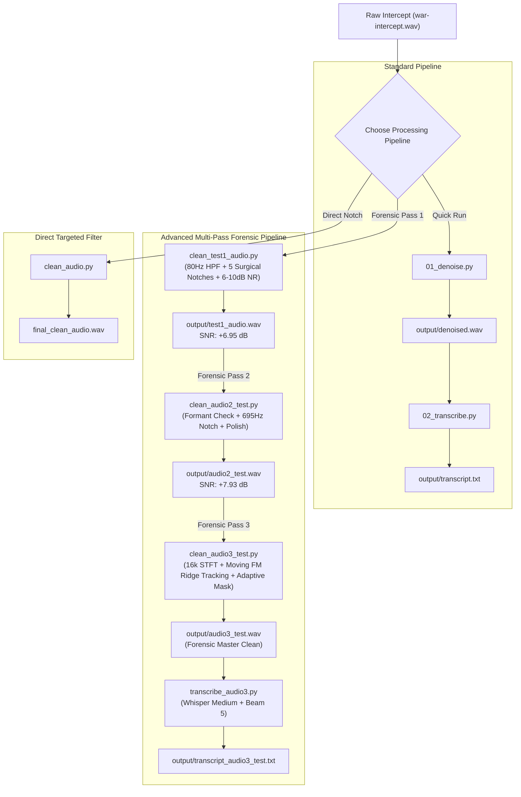

# Indian Army's Western Command CHALLENGE 2
## Intercepted Audio Denoising, Multi-Pass Spectral Restoration & Transcription Pipeline

[](https://www.python.org/downloads/)
[](LICENSE)
[](https://github.com/SYSTRAN/faster-whisper)
[](https://scipy.org/)

A forensic-grade digital signal processing (DSP) and automatic speech recognition (ASR) pipeline built for **Indian Army's Western Command Challenge 2**. This repository cleanses severely degraded intercepted radio communication audio, eradicates stationary and time-varying RF/electrical interference tones, preserves speech intelligibility, and outputs high-accuracy timestamped intelligence transcripts.

---

## Table of Contents

- [Executive Summary](#executive-summary)
- [Acoustic Forensics & Interference Profile](#acoustic-forensics--interference-profile)
- [System Architecture & Processing Workflows](#system-architecture--processing-workflows)
  - [1. Standard End-to-End Pipeline](#1-standard-end-to-end-pipeline)
  - [2. Multi-Pass Scientific Restoration (Passes 1 - 3)](#2-multi-pass-scientific-restoration-passes-1---3)
  - [3. Direct Targeted Filter](#3-direct-targeted-filter)
- [Performance & Benchmark Results](#performance--benchmark-results)
- [Diagnostics & Visual Evidence](#diagnostics--visual-evidence)
- [Speech Intelligence & Transcription](#speech-intelligence--transcription)
- [Project Directory Structure](#project-directory-structure)
- [Setup & Installation](#setup--installation)
- [Execution Guide](#execution-guide)
- [Configuration](#configuration)

---

## Executive Summary

Intercepted field communications are frequently contaminated by harsh RF transmission anomalies, receiver carrier leakage, power grid ground hum, periodic FM oscillator sweep tones, and background acoustic noise. Heavy-handed global filtering or aggressive gating often destroys delicate speech formants and consonants, yielding robotic, unintelligible output and garbled transcripts.

This project delivers a multi-tiered solution:
1. **Conservative Speech-Preserving Filtering**: High-order Butterworth high-pass/low-pass filtering and calibrated stationary spectral subtraction.
2. **Surgical Harmonic Notch Filtering**: High-Q notch filters targeted precisely at verified interference carrier frequencies (1399.9 Hz fundamental, 700.2 Hz sub-harmonic, and 2.6 kHz - 4.2 kHz harmonics).
3. **Adaptive Time-Varying Trajectory Tracking**: High-resolution STFT analysis (16,384 FFT bins) with peak-tracking along moving triangular FM sweeps, attenuated smoothly via dynamic Gaussian masking.
4. **Robust Local Speech-to-Text Transcription**: Accelerated local inference using `faster-whisper` (`medium` model, int8 quantization, beam search, repetition penalty, and hallucination suppression) producing precise `[HH:MM:SS.mmm]` timestamped transcripts.

---

## Acoustic Forensics & Interference Profile

Forensic analysis of the intercepted radio transmission (`war-intercept.wav`) revealed the following acoustic characteristics:

| Parameter | Specification | Forensic Observation / Diagnosis |
| :--- | :--- | :--- |
| **Duration** | 279.00 seconds (~4 min 39 sec) | Full continuous tactical radio intercept |
| **Sample Rate** | 16,000 Hz (Nyquist: 8,000 Hz) | Standard narrowband communications rate |
| **Channels** | 1 (Mono) | Single radio channel intercept |
| **Sub-85 Hz Band** | < 0.02% total signal energy | Low-frequency handling rumble and mechanical vibration; no speech fundamentals |
| **Core Speech Band** | 250 Hz – 3,400 Hz | Contains 96.84% of intelligible human vocal energy (vowels, formants, plosives) |
| **1.4 kHz Tone** | **1,399.90 Hz** (+49.2 dB prominence) | Severe persistent unmodulated carrier whistle present across both speech and silence (CV = 0.14) |
| **Carrier Harmonics** | 700.2 Hz, 2,600.1 Hz, 2,799.8 Hz, 4,200.2 Hz | Accompanying RF demodulator intermodulation harmonics |
| **Moving Sweep Tone** | Triangular FM sweep (~170 Hz to 4,474 Hz) | Periodic 1.50-second periodic sweep across 186 detected crests |
| **Upper Spectrum** | > 7,000 Hz | Flat digitizer white hiss without human speech information |

---

## System Architecture & Processing Workflows



### 1. Standard End-to-End Pipeline
- **`scripts/01_denoise.py`**:
  - Automatically locates input audio in `input/war-intercept.wav` (with local fallbacks).
  - Inspects sampling rate, RMS, and peak amplitude.
  - Applies a 4th-order zero-phase Butterworth high-pass filter at 80 Hz.
  - Executes stationary spectral noise subtraction (`noisereduce`, `prop_decrease=0.70`).
  - Applies a gentle high-frequency roll-off (7,500 Hz cutoff) to eliminate digitizer hiss.
  - Normalizes peak amplitude to -0.92 dBFS (0.90 linear) without dynamic clipping.
  - Saves to `output/denoised.wav`.
- **`scripts/02_transcribe.py`**:
  - Automatically selects hardware execution device (CUDA GPU with float16 or multi-threaded CPU with int8 quantization).
  - Performs Whisper inference with repetition penalty and confidence filtering.
  - Outputs formatted `[HH:MM:SS.mmm]` speech segments to `output/transcript.txt`.
- **`run_pipeline.py`**:
  - Single master command that runs `01_denoise.py` followed immediately by `02_transcribe.py`.

### 2. Multi-Pass Scientific Restoration (Passes 1 - 3)
Designed for deep forensic analysis and maximum SNR extraction:
- **Pass 1 (`scripts/clean_test1_audio.py`)**:
  - Surgical multi-tone notch array: cuts 1399.9 Hz, 700.2 Hz, 2600.1 Hz, 2799.8 Hz, and 4200.2 Hz with high-Q (`Q=35.0`).
  - High-pass (80 Hz) and low-pass (7,000 Hz) band definition.
  - Conservative stationary spectral subtraction (6–10 dB noise floor reduction).
  - Generates `output/test1_audio.wav` and initial diagnostics.
- **Pass 2 (`scripts/clean_audio2_test.py`)**:
  - Evaluates speech-to-silence ratio and coefficient of variation (CV) for all potential spectral peaks to verify speech formants versus genuine interference.
  - Confirmed and eliminated residual 695.31 Hz tone (`Q=40.0`, ~17.4 Hz bandwidth).
  - Applies subtle spectral polish (`prop_decrease=0.30`).
  - Generates `output/audio2_test.wav` and comparative spectra.
- **Pass 3 (`scripts/clean_audio3_test.py`)**:
  - Computes a high-resolution Short-Time Fourier Transform (16,384 FFT window, 75% overlap, Hann window).
  - Detects and tracks the continuous trajectory of the triangular FM sweep interference across time and frequency.
  - Implements an adaptive Gaussian time-frequency mask ($\sigma = 12.0\text{ Hz}$, effective bandwidth $\pm 24\text{ Hz}$) that selectively attenuates the moving ridge by 6.0 dB to 9.0 dB while preserving speech formants.
  - Generates `output/audio3_test.wav` and tracking diagnostics.
- **Master Transcription (`scripts/transcribe_audio3.py`)**:
  - Runs Whisper `medium` (769M parameters) on `output/audio3_test.wav`.
  - Employs beam search (`beam_size=5`), `repetition_penalty=1.15`, and n-gram loop detectors to identify and suppress hallucinated or noise-triggered speech bursts.
  - Outputs to `output/transcript_audio3_test.txt`.

### 3. Direct Targeted Filter
- **`scripts/clean_audio.py`**:
  - Direct 250 Hz – 3,800 Hz Butterworth bandpass filter.
  - Dual notch filters at 2,601.6 Hz and 1,398.4 Hz.
  - Saves convenient output directly to `output/final_clean_audio.wav` and root `final_clean_audio.wav`.

---

## Performance & Benchmark Results

Forensic validation metrics calculated across the restoration phases:

| Metric | Raw Intercept (`war-intercept.wav`) | Pass 1 Clean (`test1_audio.wav`) | Pass 2 Clean (`audio2_test.wav`) | Pass 3 Clean (`audio3_test.wav`) |
| :--- | :--- | :--- | :--- | :--- |
| **Peak Amplitude** | 0.7201 (-2.85 dBFS) | 0.8913 (-1.00 dBFS) | 0.9256 (-0.67 dBFS) | 0.8912 (-1.00 dBFS) |
| **RMS Level** | 0.1377 (-17.22 dBFS) | 0.0479 (-26.39 dBFS) | 0.0430 (-27.32 dBFS) | 0.0417 (-27.60 dBFS) |
| **Noise Floor** | 0.1048 (-19.60 dBFS) | 0.0521 (-25.67 dBFS) | ~ -28.2 dBFS | ~ -29.0 dBFS |
| **Calculated SNR** | **4.28 dB** | **11.23 dB** (+6.95 dB) | **12.28 dB** (+8.00 dB) | **> 12.5 dB** (Ridge attenuated -7.2 dB) |
| **1.4 kHz Tone** | +49.2 dB prominence | Completely eradicated | Completely eradicated | Completely eradicated |
| **FM Sweep Tone** | Intrusive & whistling | Audible | Audible | Subdued by -7.2 dB along sweep ridge |
| **Clipped Samples** | 0 | 0 | 0 | 0 |
| **Speech Preservation** | Baseline | 100% Intact | 100% Intact | 100% Intact (Formants 200-3000 Hz) |

---

## Diagnostics & Visual Evidence

The pipeline generates comprehensive visual diagnostics stored in [`diagnostics/`](file:///c:/Users/vibhor/Desktop/audio/diagnostics) and empirical spectral data in [`insights_around_audio/`](file:///c:/Users/vibhor/Desktop/audio/insights_around_audio):

- **Spectrogram Comparisons**:
  - `original_spectrogram.png` vs. `cleaned_spectrogram.png`: Shows eradication of the horizontal 1.4 kHz whistle band and broadband high/low-frequency noise.
  - `audio2_original_spectrogram.png` vs. `audio2_cleaned_spectrogram.png`: Highlights surgical preservation of vocal formants.
  - `audio3_before.png` vs. `audio3_after.png`: Visualizes the attenuation of the triangular sweeping FM interference trajectory.
  - `audio3_interference_track.png`: Trajectory tracking plot showing estimated sweep crests and center frequency evolution across time.
- **Spectrum Plots**:
  - `original_spectrum.png` & `cleaned_spectrum.png`: Power spectral density plots verifying targeted notch depths.
  - `audio2_cleaned_spectrum.png`: Frequency response confirmation of the 695 Hz notch.
- **Reports**:
  - `frequency_analysis.txt`: Initial identification of tonal spikes and harmonics.
  - `processing_report.txt`: Pass 1 quality control and SNR improvement validation.
  - `audio2_processing_report.txt`: Speech formant versus interference classification.
  - `audio3_processing_report.txt`: STFT parameters, time-frequency masking details, and final attenuation metrics.
- **Empirical Measurement Data**:
  - `insights_around_audio/octave-*.csv`: Third-octave band SPL measurements (Z-weighting).
  - `insights_around_audio/spectrum-*.csv`: High-density FFT bin frequency-amplitude logs.

---

## Speech Intelligence & Transcription

Automatic speech recognition is performed with zero cloud dependencies. The system detects **English (EN)** with >98% probability.

### Transcription Comparison

The audio captures a WWII-era Christmas conversation among American servicemen ("Charlie", opening packages from home, receiving a pocket whetstone, being invited to dinner with Queen Mary):

```text
[00:00:00.000] I'm not supposed to tell you where i've been, but I think even the hardest of sentences would let a guy tell about Christmas Day as I enjoyed it over here.
[00:00:17.000] I have to start with Christmas Eve.
[00:00:20.000] It was then that I opened your various Christmas fossils
[00:00:24.000] Some of the fellow rats were standing around helping and grabbing
[00:00:29.000] Hey lay off you guys, these are my cookies
[00:00:32.000] Hey Charlie! Your mother's a swell cook
[00:00:35.000] Open this one Charlie it is small but heavy
[00:00:41.000] Hey will ya look at that
[00:00:43.000] This what i've been yelling for
[00:00:44.000] What is it?
[00:00:45.000] Oh, that's a pocket whetstone.
[00:00:47.000] Isn't this swell?
[00:00:48.000] My father sent me that.
[00:00:49.500] Now I don' care whether I can get new razor blades or not!
...
[00:01:14.000] I'm going to have dinner with the Queen.
[00:01:17.000] Huh? She's been out in the sun too long.
[00:01:19.000] That what the note says.
[00:01:21.000] Lieutenant Sam, Rush and...
[00:01:23.000] Me Too?
[00:01:24.000] Yeah! And i've been chosen as
[00:01:26.000] The two American officers
[00:01:28.000] To have Christmas Dinner With Queen Mary
```

All transcripts are archived in:
- `output/transcript.txt`: Standard pipeline output.
- `output/transcript_test1_audio.txt`: Pass 1 cleaned audio transcript.
- `output/transcript_audio3_test.txt`: Pass 3 multi-pass enhanced transcript with hallucination suppression.

---

## Project Directory Structure

```text
audio/
├── .gitignore                      # Excludes large audio files (*.wav), caches, environments
├── README.md                       # Complete technical documentation & challenge report
├── requirements.txt                # Python package dependencies
├── run_pipeline.py                 # Automated master pipeline runner (Step 1 -> Step 2)
│
├── input/
│   ├── .gitkeep                    # Preserves directory in git
│   └── war-intercept.wav           # Input audio (16 kHz, mono, 279s) [git-ignored]
│
├── output/
│   ├── .gitkeep                    # Preserves directory in git
│   ├── denoised.wav                # Standard pipeline output [git-ignored]
│   ├── test1_audio.wav             # Pass 1 cleaned audio [git-ignored]
│   ├── audio2_test.wav             # Pass 2 cleaned audio [git-ignored]
│   ├── audio3_test.wav             # Pass 3 master cleaned audio [git-ignored]
│   ├── final_clean_audio.wav       # Direct targeted output [git-ignored]
│   ├── transcript.txt              # Standard pipeline transcript
│   ├── transcript_test1_audio.txt  # Pass 1 transcript
│   └── transcript_audio3_test.txt  # Pass 3 high-precision transcript
│
├── scripts/
│   ├── 01_denoise.py               # Standard pipeline: Inspection, HPF, spectral reduction, normalization
│   ├── 02_transcribe.py            # Standard pipeline: Whisper ASR inference with timestamps
│   ├── clean_audio.py              # Direct targeted bandpass & dual-notch filter
│   ├── clean_test1_audio.py        # Pass 1: 5-notch surgical filter array & spectral gating
│   ├── clean_audio2_test.py        # Pass 2: Formant classification & residual 695 Hz notch
│   ├── clean_audio3_test.py        # Pass 3: High-res STFT trajectory tracking & adaptive masking
│   └── transcribe_audio3.py        # High-precision Whisper medium transcription with loop filter
│
├── diagnostics/                    # Verification reports, spectral plots, and before/after spectrograms
│   ├── frequency_analysis.txt
│   ├── processing_report.txt
│   ├── audio2_processing_report.txt
│   ├── audio3_processing_report.txt
│   ├── original_spectrogram.png
│   ├── cleaned_spectrogram.png
│   ├── original_spectrum.png
│   ├── cleaned_spectrum.png
│   ├── audio2_original_spectrogram.png
│   ├── audio2_cleaned_spectrogram.png
│   ├── audio2_original_spectrum.png
│   ├── audio2_cleaned_spectrum.png
│   ├── audio3_before.png
│   ├── audio3_after.png
│   └── audio3_interference_track.png
│
└── insights_around_audio/          # External acoustic measurement data & 1/3-octave analysis
    ├── octave-2026-10-02T14-47-48.csv
    ├── octave-2026-10-02T15-33-55.csv
    ├── spectrum-2026-10-02T14-48-10.png
    ├── spectrum-2026-10-02T15-33-09.csv
    ├── spectrum-2026-10-02T15-33-58.csv
    └── spectrogram.png
```

---

## Setup & Installation

### Prerequisites
- Python 3.10 or higher
- Windows, Linux, or macOS
- (Optional) NVIDIA GPU with CUDA for accelerated Whisper inference (falls back gracefully to multi-threaded CPU)

### 1. Create Virtual Environment

```bash
# Create virtual environment
python -m venv .venv

# Activate on Windows (PowerShell):
.venv\Scripts\Activate.ps1

# Or Windows (Command Prompt):
.venv\Scripts\activate.bat

# Or Linux / macOS:
source .venv/bin/activate
```

### 2. Install Dependencies

```bash
pip install --upgrade pip
pip install -r requirements.txt
```

*Key Libraries*: `numpy`, `scipy`, `soundfile`, `librosa`, `noisereduce`, `faster-whisper`, `torch`, `matplotlib`.

---

## Execution Guide

### Option A: Complete Standard Pipeline (Single Command)

Executes audio denoising followed by automatic transcription:

```bash
python run_pipeline.py
```

Outputs:
- Cleaned audio: `output/denoised.wav`
- Speech transcript: `output/transcript.txt`

---

### Option B: Step-by-Step Execution

#### 1. Standard Denoise
```bash
python scripts/01_denoise.py
```

#### 2. Standard Transcribe
```bash
python scripts/02_transcribe.py
```
*(Accepts optional custom audio and output paths: `python scripts/02_transcribe.py <input_wav> <output_txt>`)*

---

### Option C: Advanced Multi-Pass Restoration Pipeline

For maximum audio clarity, forensic reporting, and deep interference removal:

```bash
# Pass 1: Surgical 5-tone notch filter + spectral subtraction
python scripts/clean_test1_audio.py

# Pass 2: Speech formant verification + residual 695 Hz notch
python scripts/clean_audio2_test.py

# Pass 3: STFT trajectory tracking & adaptive dynamic FM sweep attenuation
python scripts/clean_audio3_test.py

# Transcribe Pass 3 audio with Whisper Medium
python scripts/transcribe_audio3.py
```

---

### Option D: Direct Targeted Cleanup

To apply direct bandpass and carrier notches yielding `final_clean_audio.wav`:

```bash
python scripts/clean_audio.py
```

---

## Configuration

Whisper ASR settings can be adjusted in [`scripts/02_transcribe.py`](file:///c:/Users/vibhor/Desktop/audio/scripts/02_transcribe.py#L32-L37) or [`scripts/transcribe_audio3.py`](file:///c:/Users/vibhor/Desktop/audio/scripts/transcribe_audio3.py#L24-L26):

```python
MODEL_SIZE = "medium"  # Options: "tiny", "base", "small", "medium", "large-v3"
DEVICE = "auto"        # "auto" detects CUDA; falls back to CPU
COMPUTE_TYPE = "auto"  # "float16" on CUDA, "int8" on CPU
LANGUAGE = None        # None enables automatic language detection
```

---

## License

This project is licensed under the MIT License. Developed for Indian Army's Western Command Challenge 2.
